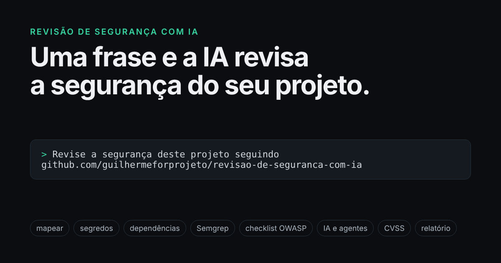

# AI security review

**A playbook for any AI to review your project's security. Just say "review the security following this repository" and paste the link.**

[🇧🇷 Português](README.md) | 🇺🇸 English



Asking "review the security" without a playbook gives shallow results: the AI skims a few files, points out generic issues and sometimes invents vulnerabilities. This repository gives it a process: map the system first, run the right tools, verify every finding before reporting it, score with CVSS and deliver a report with file, line and fix. It edits nothing unless you ask and never reveals secrets it finds.

## How to use

Open Claude Code (or Cursor, Codex, Copilot, Gemini CLI) in your project and paste:

```text
Review this project's security following https://github.com/guilhermeforprojeto/revisao-de-seguranca-com-ia . Reply and write the report in English.
```

The AI reads [`AGENTS.md`](AGENTS.md), asks about scope, asks before installing any tool and delivers a `RELATORIO-SEGURANCA.md` report. Then, if you want, it fixes things.

## Phases

0 Scope · 1 Map the system · 2 Secrets (Gitleaks) · 3 Dependencies (OSV-Scanner) · 4 Static analysis (Semgrep, CodeQL) with false-positive checks · 5 Manual review ([`CHECKLIST.md`](CHECKLIST.md)) · 6 Infra and CI (Trivy, GitHub Actions) · 7 CVSS 3.1 scoring · 8 Report ([`templates/RELATORIO.md`](templates/RELATORIO.md)) · 9 Fix, only with your OK.

Tools and Claude Code security skills (Trail of Bits, Jeffallan, BagelHole, Masriyan, FlorianBruniaux), with when to use each and caveats: [`FERRAMENTAS.md`](FERRAMENTAS.md). The files are in Portuguese; AI agents follow them in any language.

## Rules the AI follows

Read-only until you ask for fixes · no real attacks against production or third-party servers · secrets shown only as `file:line` and `sk_l****` · asks before installing anything · findings without evidence go to "To investigate".

An AI review reduces risk but does not replace a professional pentest for systems handling money, health or large amounts of personal data.

## License

[CC BY 4.0](LICENSE). If it helped, leave a ⭐.
