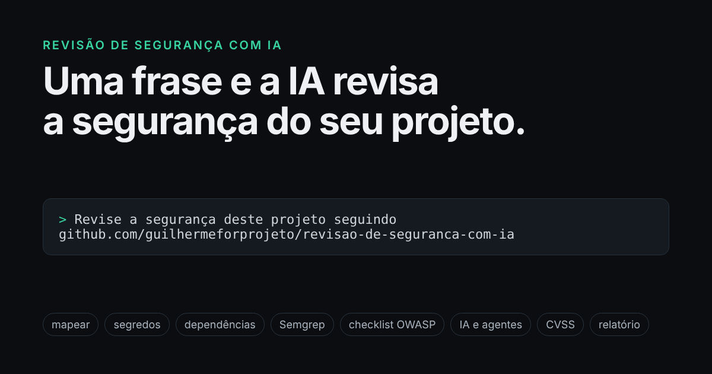

# Revisão de segurança com IA

**Um roteiro para qualquer IA revisar a segurança do seu projeto. Você só diz: "revise a segurança seguindo este repositório" e cola o link.**

🇧🇷 Português | [🇺🇸 English](README.en.md)



Pedir "revisa a segurança" sem roteiro dá resultado raso: a IA olha três arquivos, aponta coisas genéricas e às vezes inventa falha. Este repositório dá a ela um processo: mapear o sistema antes, rodar as ferramentas certas, conferir cada achado antes de reportar, classificar pela CVSS e entregar um relatório com arquivo, linha e correção. Ela não edita nada sem você pedir e nunca mostra segredos que encontrar.

---

## Como usar

Abra o Claude Code (ou Cursor, Codex, Copilot, Gemini CLI) na pasta do projeto e cole:

```text
Revise a segurança deste projeto seguindo https://github.com/guilhermeforprojeto/revisao-de-seguranca-com-ia
```

A IA lê o [`AGENTS.md`](AGENTS.md), te pergunta o escopo, pede permissão antes de instalar qualquer ferramenta e entrega um `RELATORIO-SEGURANCA.md`. Depois, se quiser, ela corrige.

Outras formas (rápida antes do deploy, só um PR, foco em SaaS ou em IA) em [`prompts/pt-BR.md`](prompts/pt-BR.md).

## O que a IA faz

| Fase | O quê | Como |
| --- | --- | --- |
| 0 | Combinar o escopo | Repositório, pasta ou PR; onde roda; multi-tenant; pode instalar ferramentas? |
| 1 | Mapear | Pontos de entrada, fronteiras de confiança, autenticação, dados sensíveis |
| 2 | Segredos | Gitleaks, incluindo o histórico do git |
| 3 | Dependências | OSV-Scanner ou o auditor do gerenciador; cadeia de suprimentos |
| 4 | Análise estática | Semgrep (e CodeQL via Trail of Bits), com cada achado conferido |
| 5 | Revisão manual | [`CHECKLIST.md`](CHECKLIST.md): acesso, injeção, sessão, uploads, SSRF, padrões inseguros, IA e agentes |
| 6 | Infra e CI | Trivy, GitHub Actions, servidor (só se for VPS) |
| 7 | Classificar | CVSS 3.1 com vetor e explicação |
| 8 | Relatório | [`templates/RELATORIO.md`](templates/RELATORIO.md) |
| 9 | Corrigir | Só com o seu OK, uma falha por commit |

**Revisão rápida** (antes de commit ou deploy): segredos, dependências e injeção, em poucos minutos.

## Ferramentas e skills

As ferramentas de linha de comando (Gitleaks, OSV-Scanner, Semgrep, Trivy) e as skills de segurança para Claude Code estão em [`FERRAMENTAS.md`](FERRAMENTAS.md), com quando usar e o cuidado de cada uma:

| Skill | Para quê |
| --- | --- |
| [trailofbits/skills](https://github.com/trailofbits/skills) | Análise estática, contexto antes de caçar bugs, checagem de falso positivo, padrões inseguros, cadeia de suprimentos |
| [Jeffallan/claude-skills](https://github.com/Jeffallan/claude-skills) (Security Reviewer) | Segundo revisor com relatório por severidade |
| [BagelHole/DevOps-Security-Agent-Skills](https://github.com/BagelHole/DevOps-Security-Agent-Skills) (`linux-hardening`) | Servidor Linux próprio (CIS, SSH, firewall) |
| [Masriyan/Claude-Code-CyberSecurity-Skill](https://github.com/Masriyan/Claude-Code-CyberSecurity-Skill) | Só as skills defensivas: varredura, web, logs, incidentes |
| [FlorianBruniaux/claude-code-ultimate-guide](https://github.com/FlorianBruniaux/claude-code-ultimate-guide) | Revisar as permissões do próprio Claude Code |

Nenhuma é obrigatória: sem ferramenta instalada, a IA faz a fase lendo o código e diz o que ficou de fora.

## Regras que a IA segue

- Somente leitura até você pedir correção.
- Nada de ataque real contra servidores em produção ou de terceiros.
- Segredo encontrado aparece só como `arquivo:linha` e `sk_l****`.
- Pergunta antes de instalar qualquer coisa.
- Achado sem evidência vai para "A investigar", não para a lista de falhas.

## No CI

Exemplos de GitHub Actions para Gitleaks e Semgrep em [`exemplos/github-actions/`](exemplos/github-actions).

## Relacionado

- [seguranca-antes-de-lancar](https://github.com/guilhermeforprojeto/seguranca-antes-de-lancar): checklist curto para o dia do lançamento. Use os dois: este para a revisão funda, aquele para a conferência final.

## Aviso

Uma revisão feita por IA reduz o risco, mas não substitui um pentest profissional em sistemas que lidam com dinheiro, saúde ou muitos dados pessoais.

## Licença

[CC BY 4.0](LICENSE): use, adapte e compartilhe, citando a fonte. As ferramentas e skills citadas têm as licenças delas.

Se te ajudou, deixa uma ⭐.
